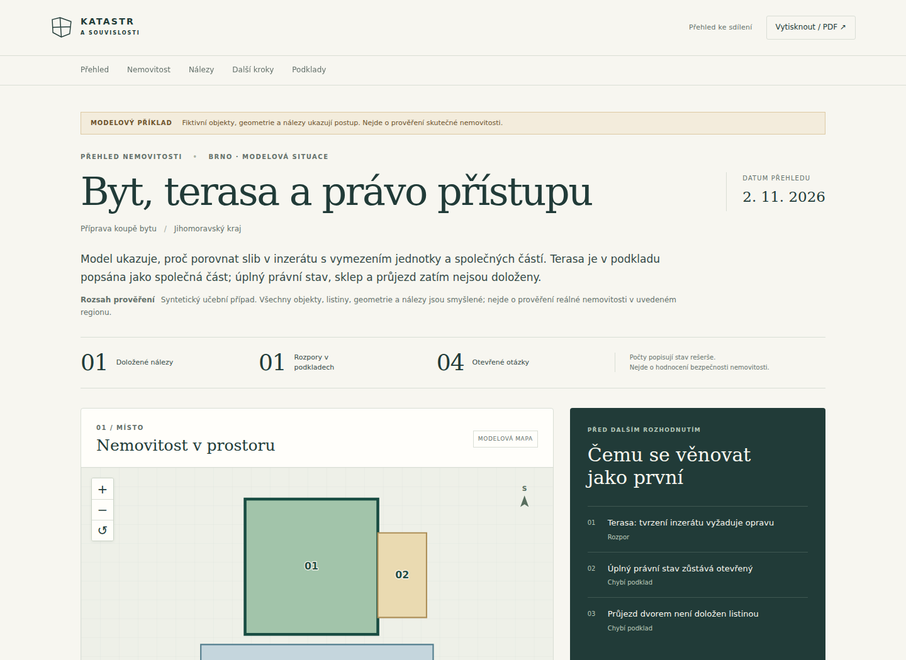

# Katastr a souvislosti

**AI skill pro nemovitosti v celé České republice.** Od adresy, parcely, jednotky nebo dodaného PDF k přehledu toho, co je doložené, co si odporuje a který další dokument má smysl získat.

Veřejný repozitář: [dnesdan/katastr-nemovitosti](https://github.com/dnesdan/katastr-nemovitosti). Verze balíčku: **0.1.0**, datový formát: `property-case/1.0`.



## Co umí

- Vést asistenta při koupi domu či bytu, stavebním záměru, porozumění vlastní nemovitosti nebo zděděným pozemkům.
- Dohledat kandidáty v RÚIAN, budovu podle kódu, přesnou parcelu přes veřejné WFS a jeden mapový výřez WMS.
- Pracovat s katalogem **28 veřejných zdrojů a přístupových cest**: územní plán, sítě, povodně, příroda, památky, geologie, kontaminace, půda, okolní záměry, internet a další podklady.
- Lokálně prohlédnout PDF/XML/text, uchovat původní hash, text po stranách, přílohy a kandidátní hodnoty; volitelně použít OCR.
- Uchovat jednotlivé důkazy, přesné podíly, časové stavy, právní vazby, rozpory a požadavky na další dokumenty.
- Vytvořit samostatný **offline HTML report s mapou, filtry a rozbalitelnými důkazy**, Markdown a GeoJSON; HTML má tiskovou podobu pro PDF.
- Připravit výslovně zkontrolovaný veřejný výběr bez interních inspekcí a nevybraných podkladů.

Skill funguje jako pracovní postup pro AI asistenta plus deterministické nástroje. **Katalog zdrojů není sada 28 automatických konektorů.** Konkrétní automatizované operace jsou uvedené níže a v nápovědě; další zdroje vyžadují průzkum asistenta nebo dokument od uživatele.

## Zkus ho takto

> Použij Katastr a souvislosti. Zvažuji koupi tohoto domu. Nejdřív potvrď správné parcely a související objekty, projdi dostupná veřejná data a vytvoř přehled s mapou. Když bude chybět konkrétní listina, vysvětli, co mám stáhnout a kterou otázku tím vyřešíme.

> Mám PDF listu vlastnictví a inzerát na byt. Porovnej je, rozliš vlastnictví terasy od práva užívání a ukaž přesné citace. Chybějící části nepovažuj za potvrzení, že nemovitost nemá omezení.

> Zdědil jsem pozemky na Vysočině. Pomoz mi rozlišit podíl, evidované užívání půdy a přístup. Pro neověřené otázky připrav konkrétní další kroky.

Žádná obec není pevnou výchozí lokalitou. Brno, Uherský Brod a Vysočina jsou příklady, nikoli podmínka funkcí.

## Instalace

```bash
git clone https://github.com/dnesdan/katastr-nemovitosti.git
cd katastr-nemovitosti
```

Pro AI klienta zkopíruj **celou složku** [skills/katastr-nemovitosti](skills/katastr-nemovitosti), včetně skriptů, referencí a assetů, do jeho adresáře skillů. Hlavní vstup jsou [instrukce SKILL.md](skills/katastr-nemovitosti/SKILL.md). Samotný clone není instalace do účtu. Konkrétní způsob načtení závisí na klientovi.

Nástroje potřebují **Python 3.10+**. Základní práce s případem, síťové klienty a HTML/Markdown/GeoJSON používají standardní knihovnu. PDF je volitelné:

```bash
python3 -m pip install -r requirements-pdf.txt
```

Na Windows lze podle instalace použít `py -3` místo `python3`. OCR navíc potřebuje Poppler (`pdftoppm`) a Tesseract; český jazykový model `ces` je vhodný, chybějící model inspektor výslovně oznámí.

## První vlastní případ

```bash
python3 skills/katastr-nemovitosti/scripts/katastr.py init --title "Můj dům" --place "Obec, okres" --purpose "Příprava koupě" --out cases/dum.json
python3 skills/katastr-nemovitosti/scripts/katastr.py plan --place "Obec, okres" --topics identity,rights,planning,water,utilities --out cases/plan.json
python3 skills/katastr-nemovitosti/scripts/katastr.py inspect muj-vypis.pdf --out cases/inspekce.json
python3 skills/katastr-nemovitosti/scripts/katastr.py add-document cases/dum.json muj-vypis.pdf --id vypis-1 --title "Dodaný výpis" --kind lv --out cases/dum-s-podkladem.json
```

`plan` vytváří plán. `inspect` čte dokument. `add-document` vloží soukromou inspekci a otevřený kontrolní úkol. **Žádný z těchto příkazů automaticky nepotvrzuje právní závěry.** Asistent poté ověří podklady a zapíše důkazy podle [datového postupu](skills/katastr-nemovitosti/references/data-a-vystupy.md).

```bash
python3 skills/katastr-nemovitosti/scripts/katastr.py validate cases/dum-s-podkladem.json
python3 skills/katastr-nemovitosti/scripts/katastr.py report cases/dum-s-podkladem.json --format html --out cases/report.html
```

Otevři `cases/report.html` v prohlížeči. **Tisknout / PDF** otevře tisk; vyber uložení do PDF. Výstup není úřední výpis. Report při otevření neposílá síťové požadavky a nepotřebuje server.

Existující soubory se nepřepisují bez `--force`. Případové soubory ukládej mimo instalovanou složku skillu.

## Veřejné služby bez klíče

```bash
# Kandidáti, bez automatického výběru prvního výsledku
python3 skills/katastr-nemovitosti/scripts/katastr.py fetch ruian "Uherský Brod" --kind cadastral

# Skutečný reprodukovatelný příklad: katastr + číslo + číselná řada
python3 skills/katastr-nemovitosti/scripts/katastr.py fetch parcel --cadastral 772984 --number 1 --series land --out cases/parcela.json

# Nejprve zjistit publikované vrstvy a jejich souřadnicové systémy
python3 skills/katastr-nemovitosti/scripts/katastr.py fetch wms
```

Další operace jsou `fetch building` a `fetch map`; jejich parametry vysvětlí `--help`. Mapa automaticky dostane sidecar `<mapa>.json` s původem; `--metadata` může přidat další kopii. Síťový klient má sdílenou cache a rozestupy, kontrolu přesměrování a jasné stavy při odmítnutí přístupu. Neprovádí automatické opakování blokovaných dotazů. [Úplná reference](skills/katastr-nemovitosti/references/nastroje-zdroju.md).

## Příklady a vzhled

| Příklad | Povaha | Co ukazuje |
|---|---|---|
| [Uherský Brod: veřejná data](examples/uhersky-brod-verejna-data.md) · [HTML](examples/uhersky-brod-verejna-data.html) · [JSON](examples/uhersky-brod-verejna-data.json) | Skutečné malé dotazy z 2. 11. 2026 | Potvrzená identita a geometrie parcely, datum a původ; právní a územní otázky zůstávají otevřené |
| [Brno: byt a terasa](examples/brno-byt-model.md) · [HTML](examples/brno-byt-model.html) · [JSON](examples/brno-byt-model.json) | Výslovně syntetický příklad | Rozpor inzerátu a vymezení terasy, neúplný výpis, podíl a nedoložený příjezd |
| [Vysočina: louka a přístup](examples/vysocina-pozemek-model.md) · [HTML](examples/vysocina-pozemek-model.html) · [JSON](examples/vysocina-pozemek-model.json) | Výslovně syntetický příklad | Rozdíl vlastnictví a užívání, návrhu a realizace cesty, neprovedených kontrol |

HTML soubory GitHub zobrazuje jako zdrojový kód; pro živé ovládání je stáhni nebo otevři z místního clone. [Mobilní ukázka](docs/nahled-mobil.png). Modelové PDF podklady jsou v [examples/podklady](examples/podklady) a mají viditelné označení, že nejde o úřední listiny. Neobsahují skutečné osobní údaje.

## Přihlášení a dokumenty

Nahlížení do KN je interaktivní služba; tento balíček ji nescrapuje. Oficiální API KN s registrací a placené WSDP mají vlastní přístupové režimy a **nejsou implementované přihlášenými adaptéry této verze**. Uživatel může získat potřebný výpis/listinu přes DPN, případně prokázat totožnost a zaplatit, a nahrát původní PDF. Skill přesně vysvětlí, co dokument rozhodne. [Přístupové režimy a primární zdroje](skills/katastr-nemovitosti/references/zdroje-a-pristup.md).

Inspekce PDF/XML není úplný parser právních vazeb LV/NTŘ ani kryptografické ověření pečeti. Částečné podklady, nejisté OCR, rozdílné časové stavy a nepodporovaný obsah jsou výslovně označené. [Postup pro PDF a listiny](skills/katastr-nemovitosti/references/pdf-a-listiny.md).

## Testování

```bash
python3 -m pip install -r requirements-dev.txt
python3 -m unittest discover -s tests -v
python3 tools/verify.py
```

Běžné testy jsou offline. Volitelné živé testy vyžadují síť a dodržení podmínek zdroje; nejsou součástí výchozího běhu. Konkrétní výsledky, nezávislé kontroly a meze ověření jsou v [TESTING.md](TESTING.md). Projekt neobsahuje CI workflow.

## Návaznost a licence

Navazuje na [Paměť krajiny](https://github.com/dnesdan/pamet-krajiny), [Dějiny podniku a řemesla](https://github.com/dnesdan/dejiny-podniku-a-remesla), [Dějiny domu](https://github.com/vzoha/dejiny-domu-skill), [Rodokmen](https://github.com/sarsonj/rodokmen-skill) a [Paměť rodu](https://github.com/thejanhromek/pamet-rodu). [Konkrétní převzaté zkušenosti a PR](skills/katastr-nemovitosti/references/navaznosti.md).

Vlastní kód a texty: [MIT](LICENSE). Externí zdroje mají své licence a přístupová pravidla; viz [THIRD_PARTY_NOTICES.md](THIRD_PARTY_NOTICES.md). Veřejný filtr je výběr zkontrolovaných dat, nikoli automatická anonymizace.
